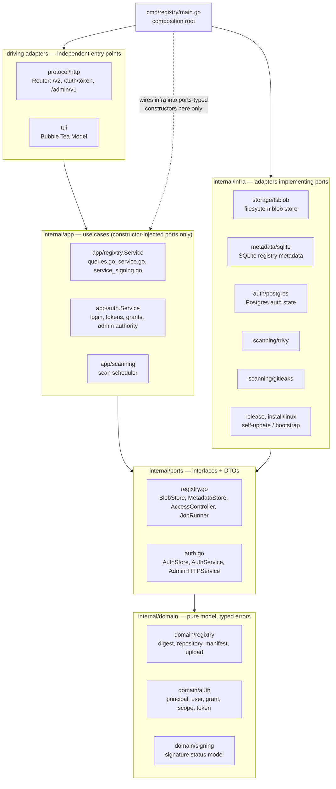
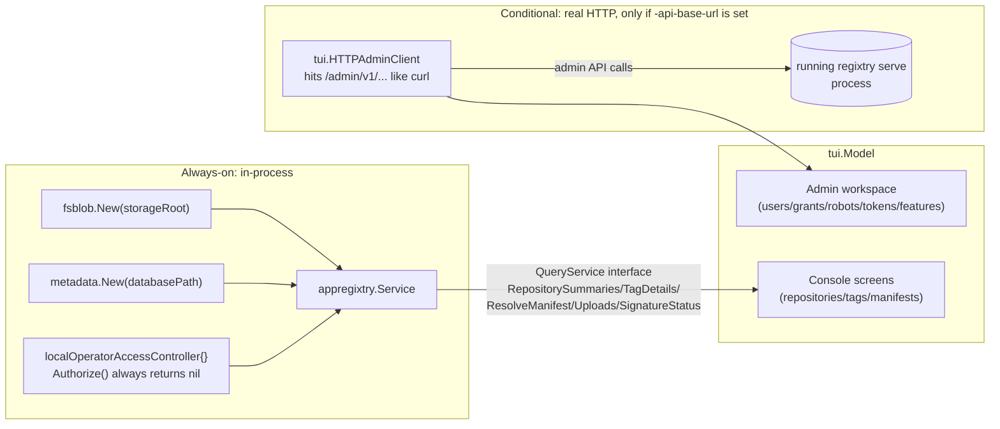
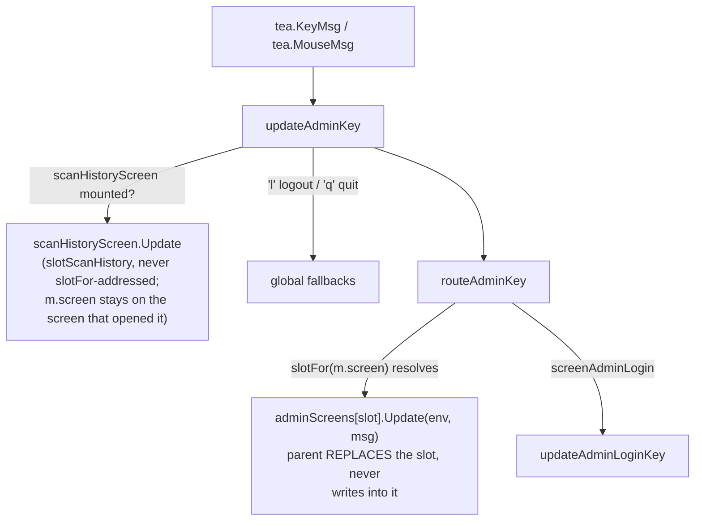

# Architecture

regixtry is a single Go binary that is, depending on the subcommand, an OCI/Docker registry server (`regixtry serve`), a Bubble Tea console (`regixtry tui`), or one-shot bootstrap/upgrade tooling. The whole codebase follows hexagonal/clean architecture: dependencies point inward, `internal/domain` knows nothing about HTTP or SQL, and `cmd/regixtry/main.go` is the only place concrete infrastructure gets wired into interfaces.

## Layer map



Arrows point in the direction of the *depends-on* relationship. `internal/infra/*` packages never import each other and never import `protocol` or `tui`. `protocol/http` and `tui` never import `infra` directly and never import each other — both only call into `app`. Only `cmd/regixtry/main.go` imports every concrete `infra` type, and it is the sole place a `ports.*` interface gets satisfied with a real implementation.

| Layer | Package(s) | Responsibility |
| --- | --- | --- |
| Domain | `internal/domain/regixtry`, `internal/domain/auth`, `internal/domain/signing` | Value objects and typed errors: digest, repository ref, manifest, upload state, principal, user, grant, scope, token. Zero imports of `internal/*` except `domain/auth` → `domain/regixtry`. |
| Ports | `internal/ports/regixtry.go`, `internal/ports/auth.go`, `internal/ports/defaults.go` | Interfaces (`BlobStore`, `MetadataStore`, `AuthStore`, `AccessController`, `AdminHTTPService`, `QueryService` consumed by the TUI, etc.) plus DTOs and default in-process implementations (`NewConfigurableAccessController`, `NewPrincipalAccessController`, `NewInlineJobRunner`). Imports only the domain packages. |
| Application | `internal/app/regixtry.Service`, `internal/app/auth.Service`, `internal/app/scanning` | Orchestration/use-cases. Constructor-injected with `ports` interfaces only — never references any `internal/infra` type. |
| Infrastructure | `internal/infra/storage/fsblob`, `internal/infra/metadata/sqlite`, `internal/infra/auth/postgres`, `internal/infra/scanning/trivy`, `internal/infra/scanning/gitleaks`, `internal/infra/release`, `internal/infra/install/linux` | Outer-ring adapters implementing `ports` interfaces. `release`/`install/linux` are self-update and bootstrap tooling — not part of the request-serving path. |
| Driving adapters | `internal/protocol/http`, `internal/tui` | Two independent entry points into `app`. Neither calls `infra` directly, neither calls the other. |
| Composition root | `cmd/regixtry/main.go` | Parses subcommands (`serve`, `tui`, `bootstrap`, `bootstrap-admin`, `setup`, `feature`, `uninstall`, `upgrade`) and is the only file that wires concrete `infra` types into `ports`-typed constructors. |

## Request lifecycle traces

### 1. Docker pull (`GET /v2/<name>/manifests/<ref>`, blob `GET`)

```
Router.handleV2 (router.go:115)
  → repository/suffix split, routes by suffix (router.go:133-178)
  → handleManifest (router.go:314) / handleBlobRead (router.go:284)
      → withPrincipal (router.go:493) — if r.auth == nil, pass through anonymously (line 494-496)
          → authenticate (router.go:510) — parses "Authorization: Bearer <token>",
            calls AuthService.VerifyAccessToken (line 530) against Postgres
      → appregixtry.Service.OpenManifest (queries.go:74) / OpenBlob (queries.go:538)
          → s.authorize(...) against the injected ports.AccessController
          → sqlite.Store.ResolveManifest (metadata) or fsblob.Store.OpenBlob (blob bytes, plain os.Open — store.go:189)
      → HTTP response with Docker-Content-Digest headers (writeBlobHeaders)
```

The decisive branch is `withPrincipal` (`internal/protocol/http/router.go:493-508`): when the router was constructed with a `nil` `ports.AuthService` (i.e. no `-auth-postgres-dsn` was configured), it returns immediately (`req, true`) and every pull is anonymous. Only when an auth service is present does `authenticate` (`router.go:510-536`) run, verifying the bearer token via `app/auth.Service.VerifyAccessToken` against Postgres. Authorization is then a second, independent check inside `appregixtry.Service` — `OpenManifest`/`OpenBlob` call `s.authorize` against whatever `ports.AccessController` the composition root chose (`configurableAccessController` for anonymous mode, `principalAccessController` once auth is enabled — see `internal/ports/defaults.go`).

### 2. Admin mutation (e.g. a repo-admin grant `PUT`)

`Router.handleAdmin` (`internal/protocol/http/admin_handlers.go:19`) implements a deliberate two-tier gate:

```go
// admin_handlers.go:39
if strings.HasPrefix(subpath, "repositories/") {
    principal, ok := r.requireAuthenticatedPrincipal(w, req)   // only proves *who*, not admin-ness
    ...
    r.handleAdminRepositoryResource(w, req, *principal, ...)   // authority decided downstream
    return
}

principal, ok := r.requireAdminPrincipal(w, req)                // every other route: global admin required
```

- `repositories/*` (line 39-46) is the **one** delegate-eligible namespace. It only checks that a bearer principal exists (`requireAuthenticatedPrincipal`, `admin_handlers.go:1202`), then defers the actual admin-vs-repo-admin decision to the service layer's `requireAdminOrRepoAdmin` (`internal/app/auth/service.go:1047-1059`), which has the repository name to check grants against — something the router-level gate never sees.
- Every other admin route (`features`, `scan-settings`, `users`, `robots`, ...) goes through the blanket `requireAdminPrincipal` (`admin_handlers.go:1217`), which hard-requires `principal.IsAdmin`.

This lets a non-global-admin user who holds a `repo-admin` grant on one repository reach `/admin/v1/repositories/{repo}/grants` without being a registry-wide admin — the only such exception in the admin surface. Mutations then go through `ports.AuthStore` into `internal/infra/auth/postgres` — a genuinely separate Postgres connection from the SQLite metadata store.

`Router.NewRouter` (`router.go:37-59`) only mounts `/admin/v1*` routes when the constructed `authService` also satisfies `ports.AdminHTTPService` (line 39-41); with no Postgres auth store, `router.admin` stays `nil` and `handleAdmin` 404s everything (`admin_handlers.go:20-23`).

### 3. TUI's dual local/HTTP nature

See [`docs/security.md`](security.md#tui-local-browsing-is-not-access-controlled--by-design) for the security implications of the local channel below — this section covers the wiring, not the access-control consequence.

`runTUI` (`cmd/regixtry/main.go:2194-2269`) wires two independent channels into the same `tui.Model`:



- **(a) Always-on, in-process.** `runTUI` directly constructs `fsblob.New` and `metadata.New` (main.go:2199-2207) and wires an `appregixtry.Service` with `localOperatorAccessController{}` (main.go:2240) — whose `Authorize` unconditionally returns `nil` (main.go:2404-2406). This is exposed to the TUI only through the narrow `tui.QueryService` interface (`internal/tui/model.go`: `RepositorySummaries`, `TagDetails`, `ResolveManifest`, `Uploads`, `SignatureStatus`, plus the in-process `DeleteManifest` and `DeleteRepository` behind the Console's delete actions, which stay gated by `-delete-enabled`). It backs the Console with **zero flags required** and **no per-user access control** — this is deliberate; local browsing through the TUI is not a security boundary.
- **(b) Conditional, real HTTP.** Only when `-api-base-url` / `REGISTRY_API_BASE_URL` is set does `runTUI` construct a `tui.HTTPAdminClient` (main.go:2226-2232, `tui.NewHTTPAdminClient` at `internal/tui/admin_client.go:87`), which issues real HTTP requests against `/admin/v1/...` exactly as `curl` would. Every admin-screen call site nil-guards this client — without the flag, admin screens are structurally unreachable, not just hidden.

Net effect: `regixtry tui` alone is a local console over whatever storage root/database path it's pointed at. Pointing the same binary at a running server's admin API additionally unlocks the full admin surface over real HTTP — the TUI never talks to `infra` on the admin side, only to another process's HTTP API.

## TUI screen-ownership model

`internal/tui`'s admin workspace is built on a per-screen state-ownership primitive (`internal/tui/screen.go`), introduced to stop a class of bug where one screen's key handler silently mutated another screen's state. Every screen, the Console browser included, is a **slot screen**; there is no shared per-screen state struct and no legacy routing table.



- **`adminScreen` contract** (`screen.go`): `ID() screen`, `Keys() screenKeys`, `Init(env screenEnv) tea.Cmd`, `Update(env screenEnv, msg tea.Msg) (next adminScreen, cmd tea.Cmd, consumed bool)`, `View(theme adminTheme, env screenEnv) screenFrame`. It is **value-typed** (`Update` returns the new value), so `Model.adminScreens`, a fixed-size `[numScreenSlots]adminScreen` array rather than a map or slice, keeps Bubble Tea's value-copy semantics. `screenFrame` has **no `Help` field**: the footer is rendered from `Keys()`, so help cannot drift from what `Update` matches.
- **Router** (`admin_router.go`, `updateAdminKey` in `model.go`): a screen id resolves through `slotFor`; non-key messages are broadcast to every mounted slot, and each screen ignores what it does not own. The login form is the only screen routed by its own function (`updateAdminLoginKey`).
- **Environment**: a screen reads the outside world only through `screenEnv` (admin client, session, console query service, layout, known repositories, clock), passed per call and never stored.
- **Navigation**: a screen never writes `m.screen`. It returns `navigate(to)`, or an `open...` command, and the parent applies the transition and mounts a fresh screen where a fresh read is wanted.
- **`scanHistoryScreen`** is the one screen not resolved through `slotFor`. It draws the whole shell over the screen that opened it (`m.screen` never changes while it is mounted) and `Esc` un-mounts it, returning to its `returnTo`.
- **Application shell** (`shell.go`): header with breadcrumb, sidebar (`shellNavGroups`), key-hint footer; `renderShell` returns exactly the terminal's rows and columns. The palette lives in `admin_theme.go` (a test fails on any color literal outside it). Terminals under 150x24 get `renderTooSmall` (`screen_too_small.go`) instead of any screen.
- **Mouse** (`mouse.go`): one switch on the Model (`F2`) and one router. A screen opts in with the `mouseScreen` interface; mouse input is translated into the arrow and `Enter` keys the screen would receive, so every guard that applies to keys applies to the mouse, and it never reaches a dialog or a destructive action.
- **One confirm primitive** (`confirm.go`, `confirmPrompt`) is embedded in each screen that needs it: `y`/`Enter` confirm (once; further presses wait for the result), `Esc` cancels, every other key is swallowed.

### Developing a screen

A new screen follows the pattern every existing one uses. Copy the closest one (`screen_users.go` for a list, `screen_robots.go` for a list with a confirm, `screen_grant_access.go` for async writes) and keep its shape.

1. **Slot.** Add a `screenSlot` constant in `screen.go`, map the screen id in `slotFor` and `newAdminScreenFor`, and add the id to `isAdminScreen` (and `isAdminPrincipalScreen` if `q` should quit there) in `model.go`. A screen with a text input or dialog also registers it in `migratedScreenCapturesTextInput`, so `q` and `l` are typed there instead of acting.
2. **Value-typed state.** All state is fields of the screen struct. `Update` returns the next value; it never keeps a pointer to a sibling.
3. **Generation ids.** Give each instance a unique id (`atomic.Uint64` counter, as `userGenerations` and `overviewGenerations` do) and put it in every async command and result message. `Update` drops a result whose id is not its own, so a late read can never land on a newer screen that reuses the slot. A result that carries an expired-session error must be recognizable (`expiredReason`) so the Model can send the operator to the login, after the generation check.
4. **In-flight guards.** Anything that issues a create, put or delete ignores `Enter` (and the repeat key) while the command is in flight, clears the guard when the result arrives, and keeps `Esc` working. A credential the backend created is never dropped (`access_secrets.go`).
5. **Keys.** Inspect keys only through `keyinput.go` helpers. Screens with a text input use `isArrowUpKey`/`isArrowDownKey`, never the `j`/`k` helpers; text fields type every letter, `Backspace` deletes, pasted text arrives with its text and is never a command. Declare the footer in `Keys()`.
6. **Destructive actions** go through `confirmPrompt` (`withTarget`, `withConsequence`, `withButtonLabel`); the closure receives the `screenEnv` at confirm time, not open time.
7. **Mouse** (optional): implement `mouseScreen` (`Mouse`, `mouseBlocked`). Build on `listMouse` and set `Open` only when `Enter` on the row is harmless.
8. **Layout.** Render through `renderShell` with `shellContentSize`; breadcrumbs go through `shellCrumb`. Use theme roles only. No line may exceed the width and no screen the height.
9. **Backend calls** go through the `AdminClient` interface (`admin_client.go`), its HTTP client, and the fake used by tests; keep the interface minimal.

Tests, in the same change:

- **Behavior** at `Update` level with the fake client (`fakeAdminClient` in `model_test.go`, `accessClient`, `accessEnv`, `accessPress` and `accessSettle` in `access_helpers_test.go`): every key of the footer, selection, empty and error states, in-flight guard, expiry, a foreign generation, and typing `j`, `k`, `q` and pasted text where an input exists.
- **Geometry** at 150x24, 151x25, 160x30, 200x40 and 220x60 in every state: empty, loading, error, long names, many rows, multibyte names.
- **Goldens** of the important states at 150x24 and 200x40 under `internal/tui/testdata/<screen>/`, each screen family with its own flag: `go test ./internal/tui -run <Test> -update-<name>` rewrites them (`-update-users`, `-update-overview`, `-update-repo-access`, `-update-delegate`, `-update-grant-screen`, `-update-robots-tokens`, `-update-robots-delete`, `-update-overrides`, `-update-scan-runs`, `-update-security-config`, `-update-update-channel`, `-update-console`, `-update-too-small`, `-update-login-confirm`). Review the diff; the footer line in a golden is the screen's real key hints.
- Mouse tests next to `mouse_screens_test.go` when the screen takes the mouse.

See [`docs/tui.md`](tui.md) for the user-facing behavior and key tables.

## Storage: two separate databases

`cmd/regixtry/main.go` opens two backing stores with different lifecycles:

| Store | Constructed | Condition | Holds |
| --- | --- | --- | --- |
| SQLite metadata (`internal/infra/metadata/sqlite`) | `metadata.New(cfg.DatabasePath)` — `newHandler` (main.go:2126) and `runTUI` (main.go:2204) | **Unconditional** | Repositories, manifests, tags, manifest↔blob relations, uploads, scan-run records, feature-runtime state |
| Postgres auth (`internal/infra/auth/postgres`) | `openAuthStore(cfg.AuthPostgresDSN)` (main.go:2100-2115, and `runTUI` main.go:2214-2224) | **Conditional** — only if `-auth-postgres-dsn` / `AuthPostgresDSN` is set | Users, robots, repo grants, admin/access tokens |

If no Postgres DSN is configured, there is no auth store at all: no admin routes get mounted (`Router.NewRouter`, above), no login, and the registry runs in anonymous-access mode gated only by `AllowAnonymousPull`/`AllowAnonymousPush` (`ports.AccessConfig`, `internal/ports/defaults.go:11-16`). Blob bytes themselves never touch either database — they live under `<storage-root>/content/blobs/sha256/<digest-hex>` on the filesystem (`internal/infra/storage/fsblob/store.go`), written via a temp-then-rename upload lifecycle (`BeginUpload`/`PutUploadChunk`/`CommitUpload`, store.go:32-162).

## Manifest/tag delete and blob garbage collection

Two separate, independently-gated mutation paths reclaim resources, deliberately kept apart because they operate at different layers with different risk profiles:

- **Manifest/tag delete** (`REGISTRY_DELETE_ENABLED`, `Service.DeleteManifest`) removes SQLite metadata rows only — a tag reference untags, a digest reference cascades to every tag pointing at it. It never touches a blob file on disk, so it is cheap and (mistakes aside) low-risk: the content-addressed blob remains, just unreferenced.
- **Blob garbage collection** (`REGISTRY_GC_DELETE_ENABLED`, `internal/app/regixtry`'s GC service, `internal/infra/storage/fsblob`) is what actually unlinks blob bytes. Because blobs are globally content-addressed with no per-repository namespace (`<storage-root>/content/blobs/sha256/<digest-hex>`), GC is necessarily a global mark-and-sweep over every tenant/repository, not a scoped operation — a blob one repository stops referencing may still be referenced by another. It is a manual, two-step report-then-delete flow (`POST /admin/v1/gc/reports` computes candidates, `POST /admin/v1/gc/reports/{id}/delete` unlinks them) rather than an automatic sweep, with a 24-hour grace window and a delete-time re-recomputation that only unlinks digests still unreferenced at that moment — mitigating the classic GC race against an in-flight upload whose manifest hasn't published yet.

Both flags default to `false`/disabled, and both are wired through the same low-churn setter shape as the rest of `Service`'s runtime configuration (`SetDeleteEnabled`/`SetGCDeleteEnabled`, `service.go`). See [`docs/registry.md`](registry.md#blob-garbage-collection) for the full operator-facing flow, audit trail, and no-recovery caveat.

## Feature registry

Vulnerability scanning (Trivy) and secret scanning (Gitleaks) are wired through a generic feature-registry pattern in `internal/app/regixtry` (`SetFeatureRuntimeManager`, `ListFeatures`, `GetFeaturePage`, ...) rather than being hard-coded into the router or the TUI. See `docs/features.md` for the registry contract, backend-declared admin pages, and runtime lifecycle (install/upgrade/rollback) — not duplicated here.

## Composition root

`cmd/regixtry/main.go` is the only file where a concrete `internal/infra` type is assigned to a `ports`-typed variable. The two paths that matter for request serving:

- `serve` → `newHandler` (main.go:2085-2192): builds `accessController`, optionally opens the Postgres auth store and swaps in `principalAccessController`, always opens `fsblob`/`sqlite`, wires `appregixtry.NewService`, and returns `regixtryhttp.NewRouter(service, authService)`.
- `tui` → `runTUI` (main.go:2194-2269): builds the always-on local `appregixtry.Service` plus the conditional `HTTPAdminClient`, described above.

Every other subcommand (`bootstrap`, `bootstrap-admin`, `setup`, `feature`, `uninstall`, `upgrade`) is one-shot tooling that also lives in `cmd/regixtry/main.go` and uses `internal/infra/release` / `internal/infra/install/linux` — it does not participate in the request-serving path shown above.
